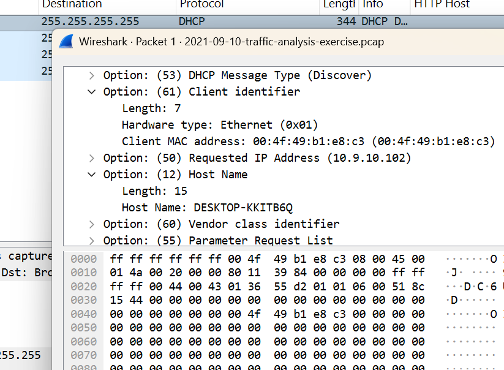
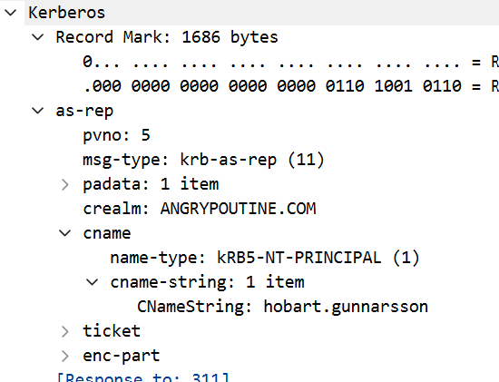
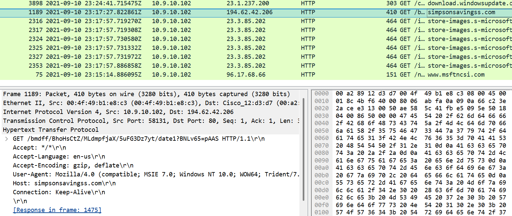
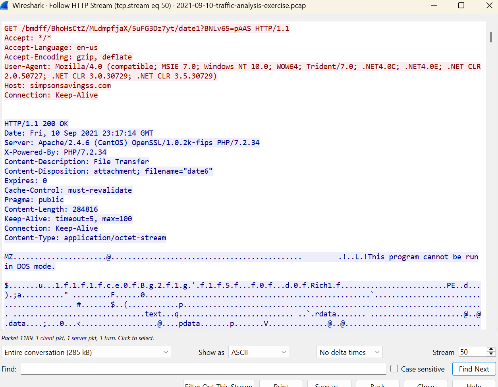

# Project 01 — Malware Traffic Investigation (Wireshark)

| | |
|---|---|
| **Analyst** | Samuel Dickson |
| **Date** | November 2026 |
| **Data source** | [malware-traffic-analysis.net](https://www.malware-traffic-analysis.net/) — traffic analysis exercise 2021-09-10 |
| **Tools** | Wireshark, tshark, VirusTotal |
| **MITRE ATT&CK** | T1105 Ingress Tool Transfer · T1071.001 Web Protocols · T1573 Encrypted Channel · T1016.001 Internet Connection Discovery |

## 1. Summary

A Windows 10 workstation (`DESKTOP-KKITB6Q`, 10.9.10.102) in the `ANGRYPOUTINE.COM` domain, used by `hobart.gunnarsson`, was infected. At 23:17:27 UTC the host downloaded a 64-bit Windows DLL over plain HTTP from `simpsonsavingss[.]com`. Within seconds it opened TLS sessions to two IP addresses with no server name and a fake certificate, checked its public IP address, and then kept calling back to `94.158.245[.]52` every 3–8 minutes until the capture ended. This pattern, together with VirusTotal detections (61/71, including a "Bazar" label), is consistent with a **BazarLoader** infection followed by command-and-control (C2) traffic.

## 2. Scope

- **Capture window:** 2021-09-10 23:15:07 UTC to 2021-09-11 00:31:57 UTC (~77 minutes)
- **Network:** 10.9.10.0/24, domain `ANGRYPOUTINE.COM`, domain controller 10.9.10.9

## 3. Infected host

| Field | Value | How I found it |
|---|---|---|
| IP address | 10.9.10.102 | Statistics → Conversations (IPv4): the only internal host talking to external IPs |
| MAC address | 00:4f:49:b1:e8:c3 | `dhcp` → Client MAC address |
| Hostname | DESKTOP-KKITB6Q | `dhcp` → Host Name option; confirmed with `nbns` |
| User account | hobart.gunnarsson | `kerberos.CNameString` |
| Domain | ANGRYPOUTINE.COM | `kerberos.CNameString` → realm; `nbns` |





## 4. Investigation

### 4.1 Overview of traffic

Most of the traffic was normal Windows background activity: Windows Update, Microsoft Store, telemetry, Bing and Office. Filtering on web traffic and reading the Host and TLS Server Name columns made the few non-Microsoft destinations stand out.

### 4.2 Malicious download (initial payload)

```
http.request
```

The only non-Microsoft HTTP request in the capture:

| Field | Value |
|---|---|
| Time | 2021-09-10 23:17:27 UTC |
| Request | `GET hxxp://simpsonsavingss[.]com/bmdff/BhoHsCtZ/MLdmpfjaX/5uFG3Dz7yt/date1?BNLv65=pAAS` |
| Server | 194.62.42[.]206 (port 80) |
| User-Agent | `Mozilla/4.0 (compatible; MSIE 7.0; Windows NT 10.0; ...)`, which claims to be Internet Explorer 7 on Windows 10. This is a red flag, because a real browser on Windows 10 wouldn't send it. |
| Response | `200 OK`, `application/octet-stream`, 284,816 bytes, served as attachment `date6` from an Apache/PHP server |
| File type | 64-bit Windows DLL (PE32+). The stream begins with `MZ` and "This program cannot be run in DOS mode" |
| SHA256 | `eed363fc4af7a9070d69340592dcab7c78db4f90710357de29e3b624aa957cf8` |

Seconds earlier (23:17:20–23:17:22) the host contacted Office services (`office15client.microsoft.com`, `nexus.officeapps.live.com`). This suggests a Microsoft Office document was opened just before the download, a common delivery method for malicious macros. This is an inference from timing, not confirmed by the pcap.





### 4.3 Command-and-control (C2) behaviour

```
tls.handshake.type == 1
```

Two TLS destinations had **no Server Name (SNI)**. Every legitimate HTTPS connection in the capture had one.

| Server | First seen (UTC) | Behaviour |
|---|---|---|
| 167.172.37[.]9:443 | 23:17:31 | One session, about 303 kB downloaded to the host. Likely a follow-up payload. |
| 94.158.245[.]52:443 | 23:17:36 | 33 TLS sessions, repeating every ~3–8 minutes until 00:31:24. This is C2 beaconing. |

Both servers presented the same suspicious certificate: subject `londonareloeli.uk`, organisation `UK System`, location `London, LL EST`. This looks fake or self-signed and is another strong indicator of malicious infrastructure.

```
ip.dst == 94.158.245.52 && tls.handshake.type == 1
```

### 4.4 Public IP check

At 23:19:21 the host looked up `myexternalip[.]com` (34.117.59[.]81). Malware commonly checks the victim's public IP address after infection, to report it to the attacker or to check its location.

### 4.5 Threat intelligence checks

VirusTotal results, checked November 2026:

| Indicator | VirusTotal | Notes |
|---|---|---|
| SHA256 eed363fc… (DLL) | **61/71** vendors flag as malicious | Labels include `Trojan.Agent.Bazar` (ALYac), `Kryplod` (Antiy, CTX, Alibaba) and `Quantum` (BitDefender, Arcabit). Tags: 64-bit, DLL, persistence, long-sleeps, detect-debug-environment |
| simpsonsavingss[.]com | **11/92** | Payload download domain |
| 167.172.37[.]9 | **6/92** | Follow-up download, fake cert |
| 194.62.42[.]206 | **1/92** | Hosted the DLL |
| 94.158.245[.]52 | 0/92, but VirusTotal lists 10+ detected malware files communicating with it | C2, 33 beacons |

**Assessment:** the "Bazar" label, the 64-bit DLL loader, and the C2 over TLS with fake certificates are consistent with **BazarLoader**. In 2021, BazarLoader was commonly delivered by malicious Office documents and was used as an entry point for follow-on attacks, including ransomware. The low IP scores reflect that this infrastructure is from 2021 and has since been reassigned. This is why IP-based indicators age quickly and file hashes are more durable.

## 5. Timeline (UTC)

| Time | Event |
|---|---|
| 2021-09-10 23:15:07 | Capture starts; DESKTOP-KKITB6Q gets 10.9.10.102 via DHCP |
| 23:17:20 | Host contacts Office services (possible document opened) |
| 23:17:27 | DNS lookup and HTTP GET to simpsonsavingss[.]com; 64-bit DLL downloaded |
| 23:17:31 | TLS (no SNI, fake cert) to 167.172.37[.]9; ~303 kB downloaded |
| 23:17:36 | First TLS connection to C2 94.158.245[.]52 |
| 23:19:21 | Public IP check via myexternalip[.]com |
| 23:19 – 00:31 | Repeated C2 connections to 94.158.245[.]52 every ~3–8 minutes |
| 2021-09-11 00:31:57 | Capture ends; host still beaconing |

## 6. Indicators of Compromise (defanged)

| Type | Indicator | Context |
|---|---|---|
| Domain | simpsonsavingss[.]com | Payload download |
| URL | hxxp://simpsonsavingss[.]com/bmdff/BhoHsCtZ/MLdmpfjaX/5uFG3Dz7yt/date1?BNLv65=pAAS | 64-bit DLL |
| IP | 194.62.42[.]206 | Payload server (HTTP/80) |
| IP | 167.172.37[.]9 | TLS/443, no SNI, follow-up download |
| IP | 94.158.245[.]52 | TLS/443, no SNI, C2 beaconing |
| TLS cert | Subject CN `londonareloeli.uk`, O `UK System` | Fake cert on both C2 IPs |
| SHA256 | eed363fc4af7a9070d69340592dcab7c78db4f90710357de29e3b624aa957cf8 | Downloaded DLL |
| User-Agent | `Mozilla/4.0 (compatible; MSIE 7.0; Windows NT 10.0; ...)` | Used by the downloader |

## 7. MITRE ATT&CK mapping

| Tactic | Technique | Evidence |
|---|---|---|
| Initial Access | T1566.001 Spearphishing Attachment (*suspected*) | Office activity seconds before the download |
| Command and Control | T1105 Ingress Tool Transfer | DLL over HTTP; 303 kB over TLS from 167.172.37[.]9 |
| Command and Control | T1071.001 Web Protocols | HTTP and HTTPS used for payload delivery and C2 |
| Command and Control | T1573 Encrypted Channel | TLS C2 with no SNI and a fake certificate |
| Discovery | T1016.001 Internet Connection Discovery | Lookup of myexternalip[.]com |

## 8. Recommendations

- **Contain:** isolate DESKTOP-KKITB6Q (10.9.10.102) from the network immediately and reimage it.
- **Credentials:** reset the password for `hobart.gunnarsson` and review their recent logons across the domain, since the host was domain-joined.
- **Block:** add the domain, IPs and URL above to the firewall, web proxy and DNS blocklists.
- **Hunt:** search proxy, DNS and firewall logs for any other hosts contacting these indicators, or making TLS connections with no SNI to bare IP addresses.
- **Detect:** alert on outdated User-Agents such as MSIE 7.0 coming from Windows 10/11 hosts, and on HTTP downloads of executables or DLLs served as `application/octet-stream`.
- **Prevent:** block Office macros from the internet (Group Policy) and run phishing awareness training.

## 9. What I learned / what I missed

- **Most of a capture is noise.** The vast majority of this traffic was normal Windows activity. Adding Host and TLS Server Name columns turned thousands of packets into a short list of outliers within minutes.
- **The absence of something is a signal.** The C2 servers stood out because their TLS connections had *no* server name, when every legitimate HTTPS connection did.
- **Small details give malware away.** The fake IE7 User-Agent on a Windows 10 host and the made-up certificate details were both strong indicators on their own.
- **Indicators age.** The C2 IP now scores 0/92 on VirusTotal, but the DLL hash still scores 61/71. Hashes and behaviour (beaconing, no SNI) are more durable detections than IP addresses.
- **Next time:** I'll compare against the official answers PDF earlier, and add a beacon-interval chart (Statistics → I/O Graph filtered on the C2 IP) to show the C2 pattern visually.

---
*Data: [malware-traffic-analysis.net](https://www.malware-traffic-analysis.net/) by Brad Duncan. The pcap and malware are not included in this repo.*
